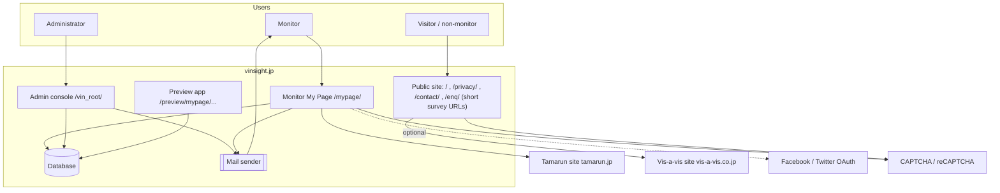
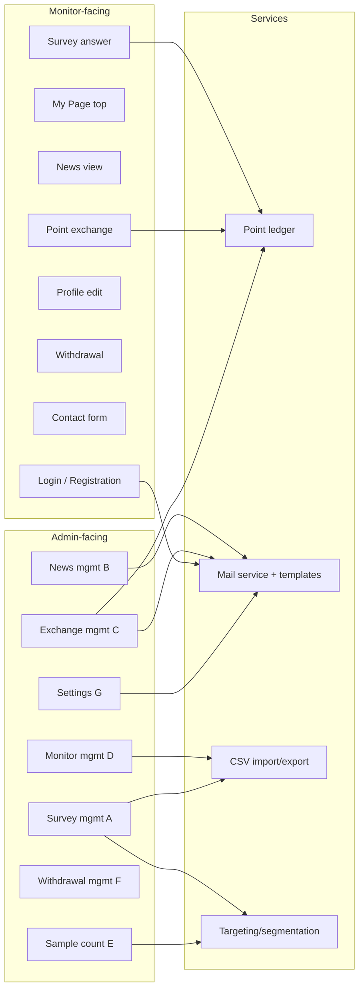

# Architecture

> **Important:** none of the source files is an architecture document. Everything below is **inferred** from URLs, parameter names, UI behaviour and remarks in the crawl-based specs. Confidence is labelled. Treat this as the "as-is" picture to be validated with the incumbent developer.

## 1. System context

## 2. Observed technical characteristics

| Aspect | Observation | Confidence |
|--------|-------------|------------|
| Language | **PHP** (`index.php`, `?c=…` query-string routing) | High |
| Routing | Front-controller by `c` parameter: `?c=<module>[_<n>]&pk=<id>&new=1`. Suffix numbers denote actions (see §4) | High |
| Admin base path | `/vin_root/index.php` | High |
| Monitor base path | `/mypage/`, sub-folders `topics/`, `trade/`, `edit/`, `secession/` | High |
| Separate apps | `/mypage/` and `/topics/` are separate from `/vin_root/` ("別アプリ、/topics/配下") | Medium |
| Preview | `preview/mypage/questionnaire/index.php` uses a **different (obfuscated) ID** than the internal pk – considered good design in the source | High |
| Short URLs | `https://vinsight.jp/enq/…` auto-numbered, public survey-answer URL | High |
| Editor | CKEditor for news body, with `%%img1%%`–`%%img3%%` image placeholders | High |
| UI | Server-rendered pages; JS buttons (`type=button`) for navigation/edit; in-page accordion for survey rows; scrollable news list | High |
| Templating of mail | `%%var%%` placeholder syntax | High |
| Captcha | Image CAPTCHA on exchange form; reCAPTCHA on contact form | High |
| Paging | Inconsistent: surveys all-at-once (597), news/exchanges/withdrawals 50/page, monitors 1000/page | High |
| Auth | Separate login for admin (single shared ID/password in settings) and monitors (e-mail/ID + password); session-based | Medium |
| SNS login | Facebook / Twitter OAuth blocks exist (JS), shown as "not linked" | Medium |
| Hosting | Unknown | — |
| Database | Unknown (likely MySQL/MariaDB with PHP) | Low |

## 3. Logical component view

## 4. Route/action naming convention (`c` parameter)

Pattern deduced from the URL list:

| Suffix | Meaning (inferred) | Example |
|--------|--------------------|---------|
| *(none)* | List screen | `?c=questionnaire&new=1&odr=1` |
| `_1` | Create/edit form (or detail view) | `?c=questionnaire_1&pk=ID&new=1` |
| `_3` | Delete | `?c=questionnaire_3&pk=ID` , `?c=topics_3&pk=ID` |
| `_5` | Toggle / expand (`is_open=`) | `?c=questionnaire_5&pk=ID&is_open=…` , `?c=topics_5…` , `?c=monitor_5…` |
| `_6` | Question list | `question_6` (actual module behind `?c=question`) |
| `_7` | Test delivery / preview | `?c=questionnaire_7&pk=ID` , `question_7` |
| `_csv`, `_csv2` | Downloads | `questionnaire_csv`, `questionnaire_csv2&type0=1&preview=1` |
| `new=1` | Reset/fresh search state or "new" flag | most links |
| `pk` | Primary key | |
| `odr`, `sort` | Ordering (`sort=status|point|title|question_num|ans_num|ans_par|start_date2`) | |
| `login_2`, `login_3` | Monitor logout, admin logout | |

## 5. Environment/URL inventory

| Area | URL |
|------|-----|
| Admin login | `https://vinsight.jp/vin_root/index.php` |
| Monitor My Page | `https://vinsight.jp/mypage/` |
| News detail | `/mypage/topics/index.php?c=topics_view&pk=ID` and public `/topics/index.php?c=topics_view&pk=ID` |
| Point exchange | `/mypage/trade/index.php` |
| Profile edit | `/mypage/edit/index.php` |
| Withdrawal | `/mypage/secession/index.php` |
| Contact | `/contact/` |
| Privacy policy | `/privacy/` |
| Short survey URL | `/enq/…` |
| Survey preview | `/preview/mypage/questionnaire/index.php?c=questionnaire_1&pk=<obfuscated>` |

## 6. Replacement architecture considerations

These are derived from the requirements, not prescribed by the sources:

| Concern | Implication |
|---------|-------------|
| **Authentication** | Replace single plaintext shared admin credential with per-user admin accounts, hashed passwords, password-reset-by-link instead of e-mailing the password. |
| **Point ledger** | Requirements 6, 33, 34 (expiry, manual grant, grant list) imply a **transaction ledger** (grants, redemptions, expiry) rather than a single balance column. |
| **Notification service** | News e-mail (15), individual delivery (14), test delivery (12), template engine with placeholders. Needs queueing and bounce tracking (mail-undelivered count already exists). |
| **Segmentation engine** | Survey delivery conditions (A-1-4), sample-count (E-1) and CSV export (25) should share one query/filter definition over monitor attributes. |
| **Role separation** | Two inquiry forms (monitor vs non-monitor), monitor vs admin apps. |
| **Preview & public IDs** | Keep the pattern of non-guessable public IDs separate from DB keys. |
| **Data migration** | Monitors (3,810), surveys (597), news (221), exchanges (5,835), withdrawals (333). Legacy CSV lacks e-mail/password (see [registration-form-redesign.md](registration-form-redesign.md)). |
| **Taxonomy mapping** | Industry / job type / employment status redefined; legacy → new mapping table required. |
| **i18n** | JP/EN surveys at least. |
| **Auditability** | Admin edit of monitor data (32) and manual points (33) call for an audit log. |
| **Hardening** | Add CSRF protection on state-changing GET links (`is_open`, delete use GET params), CAPTCHA retained on public forms. |
