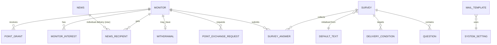
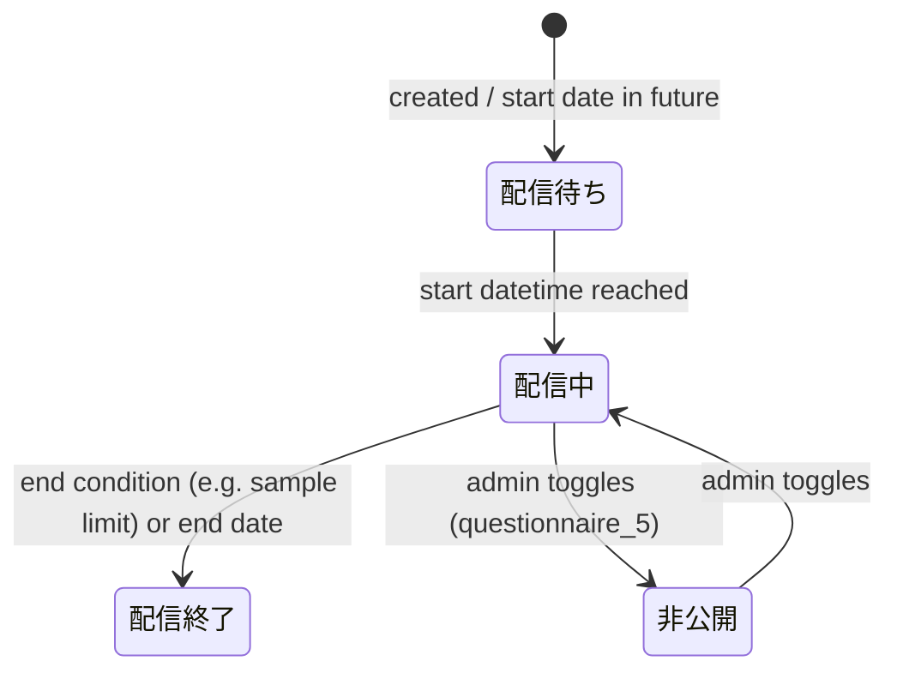
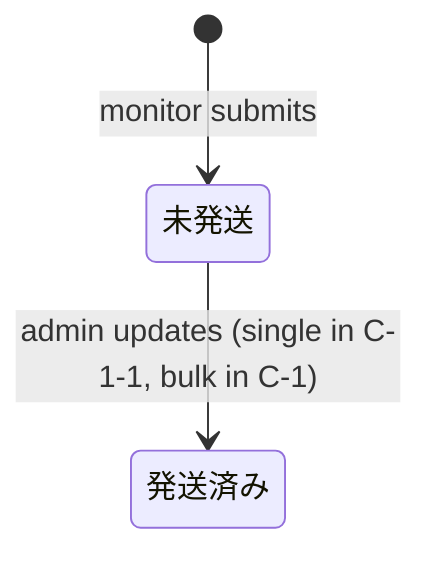
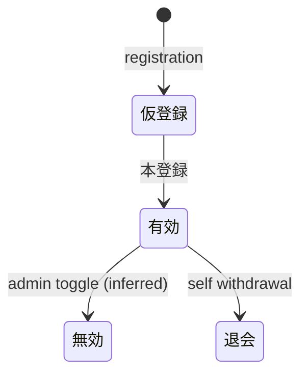

# Data Model (inferred)

No schema was provided. The model below is reconstructed from screens, CSV field names and the registration comparison sheet. Names are descriptive, not actual table names.

## 1. Entity-relationship overview

## 2. Entities

### 2.1 Monitor (モニター)

| Attribute | Notes |
|-----------|-------|
| monitor_id (モニターID / モニター番号) | Public membership number. Terminology inconsistent: "ID" vs "モニター番号" (Req. 2) |
| email, password | Password plain text in current system; legacy CSV export cannot provide these |
| birth_date, gender, marital_status, child_count | |
| occupation (職業) | 13 legacy categories |
| industry (業種) | 26 legacy categories (24 shown in the My Page select) |
| postal_code, prefecture, city, street_address | Old form: 市区町村 + 丁目・番地 |
| registered_at, last_login_at, last_answered_at, personal_info_changed_at | |
| answer_count, points_balance, exchange_count, exchange_points_total | Derived/aggregate fields |
| mail_bounce_count | "メール不達回数" |
| status | Valid / invalid (有効/無効) |
| remark (備考) | Only admin-editable field today |
| sns_link_facebook / twitter | Present as UI but slated for removal |

**"Active member" definition** (sample-count screen): answered within the last **90 days** and e-mail not undeliverable.

### 2.2 Survey (アンケート)

| Attribute | Notes |
|-----------|-------|
| id | Sequential (e.g. 763) |
| language | 日本語 / English |
| client_name | Free text; blank for "main survey" type in places |
| title | |
| type | 事前アンケート, 本アンケート, オープンアンケート, ウェルカムアンケート, カラーイメージアンケート (more may exist) |
| cookie_control_disabled | Only for open surveys |
| reward_points | May be blank |
| pre_text, post_text, request_mail_text | Initialised from DEFAULT_TEXT |
| short_url | `https://vinsight.jp/enq/…` auto-numbered |
| created_at, valid_flag | |
| status | 配信待ち / 配信中 / 配信終了 / 非公開 |
| start_datetime (配信開始日) | |
| question_count, sample_count, answer_count, answer_rate | Aggregates; sample_count = intended target |
| end_condition | e.g. "end when sample limit N reached" |
| public_id | Alternate non-guessable ID for preview |

### 2.3 Question / Delivery condition

- **Question:** text, answer format (single/multi/free text – not visible from the list), order; list shows only question text.
- **Delivery condition (配信条件):** attribute filter set identical in kind to the sample-count filters (sex, age, occupation, …); start datetime; end condition. "登録はありません" if none.

### 2.4 News (新着情報)

date, publish_from, publish_to, title, body (rich HTML), images 1–3 (`%%img1%%…`), display_place (before login / My Page), publish_flag, derived state (公開中/公開終了). **New:** individual recipients (Req. 14) and e-mail notification (Req. 15).

### 2.5 Point exchange request (ポイント交換申請)

| Attribute | Notes |
|-----------|-------|
| request_date, monitor_id | |
| name, address (postcode, pref, address1, address2), phone, email, birth date | Entered on the form; list shows name blank in many rows (observed) |
| items | QUOカードpay, Amazonギフト券(eメールタイプ), たまルンポイント, plus legacy 図書券 / クオカード; units of **500 points** |
| tamarun_card_no | Only for Tamarun; "0526…" 13-digit rule suspected |
| points_used | |
| status | 未発送 / 発送済み |
| remark | |

**Open issue (Req. 18):** after "shipped", personal data should be retained; today it may be wiped (requests before 2021-07-19 appear cleared).

### 2.6 Withdrawal (退会)

withdrawn_at, monitor_id (link to monitor record), reason (free text, often blank).

### 2.7 Default text / Mail template / System setting

| Entity | Contents |
|--------|----------|
| DEFAULT_TEXT (A-2) | pre-survey text, post-survey text, request mail text |
| MAIL_TEMPLATE (G-2) | 仮登録完了, 本登録完了, ポイント交換申込受付確認, 商品発送, パスワードお問い合わせ, + 本登録URL string |
| SYSTEM_SETTING (G-1) | admin ID, admin password, from-address, notification-to addresses (comma-separated) |

### 2.8 New entities implied by requirements

| Entity | From |
|--------|------|
| POINT_GRANT (manual grant + list) | Req. 33, 34 |
| POINT_EXPIRY (optional) | Req. 6 |
| INQUIRY (monitor vs non-monitor) | Req. 1, 3 |
| NEWS_RECIPIENT (individual delivery) | Req. 14 |
| MONITOR_INTEREST / MONITOR_MEDIA (new profile items) | see [registration-form-redesign.md](registration-form-redesign.md) |
| TEST_DELIVERY log | Req. 12 |

## 3. State machines

### Survey status

*(Transitions inferred from labels; the “is_open” toggle and automation rules are not confirmed. On 2026-09-17 every survey was “配信済”, so edit was unavailable.)*

### Exchange request

### Monitor

### News
`publish_flag` + `publish_from/to` → 公開中 / 公開終了 (computed, probable).
