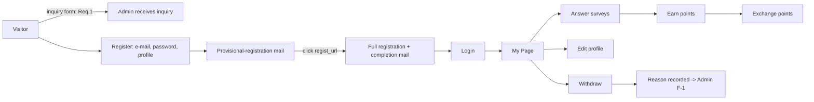
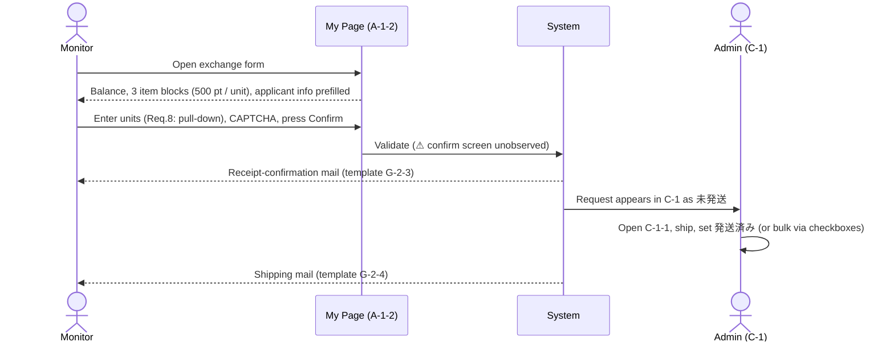
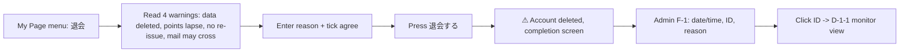

# Flows

Screen-transition flows are in [sitemap-and-urls.md](sitemap-and-urls.md). This file shows **business/process flows**. Where a step was never observed in the existing system it is marked ⚠.

## 1. Monitor lifecycle


⚠ The public registration screens and the survey-answer screens are not part of the shared materials.

## 2. Survey lifecycle (admin)

```mermaid
flowchart TD
  S1[A-2 Maintain default texts] --> S2[A-1-1 Create survey]
  S2 -->|copy: Req.11| S2
  S2 --> S3[A-1-3 Define questions]
  S3 --> S4[A-1-4 Delivery conditions + end condition]
  S4 --> E1[E-1 Sample-count check - optional]
  S3 --> PV[Preview - external obfuscated ID]
  S4 --> TD[Test delivery to admin address only - Req.12]
  TD --> ST[Status: 配信待ち]
  ST --> RUN[配信中: request mail sent to targeted monitors]
  RUN --> ANS[Monitors answer via /enq/ short URL or My Page]
  ANS --> END[配信終了: sample limit reached]
  END --> CSV[Download CSV: label table / raw data / raw (no zero) / test variants]
  ANS --> PTS[Points granted to respondents]
```

Notes
- Default pre-text, post-text and request-mail text (A-2) pre-fill each new survey.
- Request-mail placeholders: `%%id%%`, `%%question_id%%`, `%%title%%`, `%%end_date%%`, `%%end_count%%`, `%%count%%`, `%%point%%`.
- Once a survey is "delivered" the edit screen shows read-only data — i.e. there is effectively **no edit after delivery** (all 597 surveys were delivered on 2026-09-17).
- Survey types include *pre-survey*, *main survey*, *open survey* (Cookie control option), *welcome survey*, *colour-image survey*.

## 3. Point exchange flow



Item rules
| Item | Rule |
|------|------|
| QUOカードPay | 500 pt per unit; digital gift sent to registered e-mail |
| Amazonギフト券 (e-mail type) | 500 pt per unit; digital gift sent to registered e-mail |
| たまルンポイント | 500 pt per unit; requires Tamarun card number (13 digits, fixed prefix "0526" displayed); only for Tamarun card members |
| Legacy items | 図書券, クオカード appear in historical admin data |

## 4. Withdrawal flow



## 5. News flow

```mermaid
flowchart LR
  A1[Admin B-1-1: date, publish window, title, CKEditor body, images 1-3, place, publish flag] --> P{Place}
  P -->|before login| TOP[Public top]
  P -->|My Page| MP[My Page news list]
  A1 -.new Req.15.-> MAIL[Send e-mail at publish]
  A1 -.new Req.14.-> IND[Individual delivery to chosen monitors]
```

## 6. Sample-count flow
Admin sets filters (birth range, age, gender, marital, children, occupation (13), industry (26), postcode, prefecture, city, "active members only") → **表示** → result "全体 n人 / サンプル数 n人" (counts only; no list).

## 7. Settings & mail flow

| Trigger | Template | Variables |
|---------|----------|-----------|
| Provisional registration | 仮登録完了メール | `%%id%%`, `%%regist_url%%`, `%%mail%%` |
| Full registration | 本登録完了メール | `%%id%%` |
| Exchange application | ポイント交換申込受付確認メール | `%%id%%`, `%%item%%`, `%%postcode%%`, `%%pref%%`, `%%address1%%`, `%%address2%%`, `%%name%%`, `%%tel%%`, `%%mail%%` |
| Item shipped | 商品発送メール | same as above |
| Password enquiry | パスワードお問い合わせメール | `%%id%%`, `%%password%%` (⚠ plain-text password mailed) |
| Survey request | 依頼メール文 (per survey) | see §2 |

Details in [email-templates.md](email-templates.md).

## 8. Requested new flows

```mermaid
flowchart TD
  subgraph Manual points
    MG[Admin grants points (Req.33)] --> GL[Grant list (Req.34)]
    MG --> NOTI[Optional individual news: expiry notice (Req.14)]
  end
  subgraph Inquiries
    NV[Non-monitor form on login screen (Req.1)] --> IA[Admin inbox / notify address G-1-(4)]
    MV[Monitor form in My Page w/ monitor info (Req.3)] --> IA
  end
  subgraph Monitor maintenance
    ME[Admin edits monitor info (Req.32)] --> LOG[Audit log recommended]
  end
```
