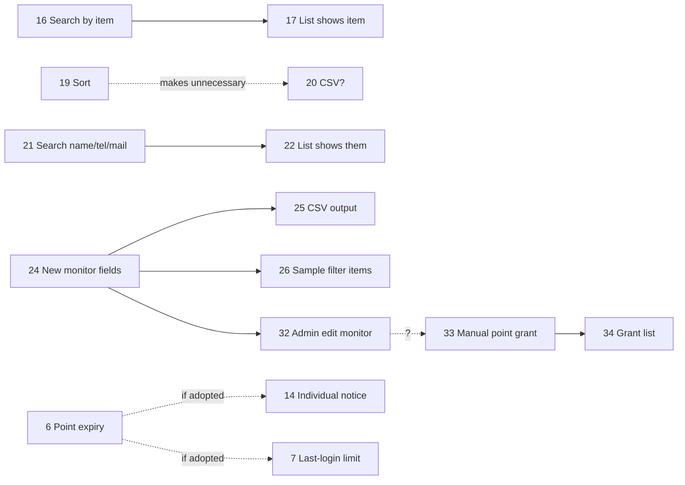

# Requirements (要求事項)

Source: `③Vinsight_要求事項（案）.xlsx` – *Rev.1, internal draft, created 2026-09-19 by 佐藤 (株式会社ビザビ). Priorities and necessity to be settled in internal discussion before submission to the vendor.*

## 1. How to read the source table

| Term | Meaning |
|------|---------|
| **重要度 (priority)** | ◎ = high, ○ = medium, △ = low, × = no action needed |
| **対応区分 (type)** | 追加 add · 変更 change · 統一 unify · 削除(非表示) delete/hide · 確認 confirm · 無し none. "（必要か？）" = it is not yet decided whether the change is needed at all |
| **ステータス (status)** | 確定 confirmed · 要検討 under consideration · 対応不要 no action |
| **Red No.** | Item is marked with circles/arrows on a screen-capture sheet (existing screens). Black = new feature that cannot be shown on a capture |
| **関連するNo.** | Dependency on another requirement |

Screen groups: `A–G` refer to admin menu groups (see [sitemap-and-urls.md](sitemap-and-urls.md)). Monitor-side items use A-1 / A-2 within the My Page numbering.

## 2. Summary statistics

| Status | Count |
|--------|-------|
| Confirmed (確定) | 18 |
| Under consideration (要検討) | 11 |
| No action (対応不要) | 6 |
| **Total** | **35 rows** (Nos. 1–34, with No. 9 split into 9-1 / 9-2) |

(Counts derived from the table. The sheet lists rows in screen order, so No. 32–34 appear out of numeric sequence.)

## 3. Full requirement list

### 3.1 Login / TOP (non-monitor)

| No. | Target | Pri. | Type | Status | Detail |
|-----|--------|------|------|--------|--------|
| 1 | TOP – inquiry form | ◎ | Add | Confirmed | New inquiry form for **non-monitors (general public)** on the login screen. |

### 3.2 Monitor screens

| No. | Screen | Target | Pri. | Type | Status | Detail |
|-----|--------|--------|------|------|--------|--------|
| 2 | A-1 My Page TOP | "ID" vs "Monitor number" | ◎ | Unify | Confirmed | Remove inconsistent naming between 「ID」 and 「モニター番号」. |
| 3 | A-1 | Inquiry form | ◎ | Change | Confirmed | Make it a **monitor-only** form (separate from non-monitor form, No. 1). Monitor form lives inside My Page and shows monitor information. |
| 4 | A-1 | SNS "easy login" | ◎ | Delete/hide | Confirmed | Remove or hide the Facebook/Twitter linkage block. |
| 5 | A-1 | Survey type display | △ | Confirm | Under consideration | Should list display differ by type ("pre-survey" vs "main survey")? |
| 6 | A-1 | Point expiry display | ○ | Add (needed?) | Under consideration | Show point expiry — only if points are given an expiry. |
| 7 | A-1 | Login info | △ | Add (needed?) | Under consideration | Show last-login — only if a last-login limit rule is introduced. |
| 8 | A-2 Point exchange | Point exchange input | ◎ | Change | Confirmed | Change to **pull-down** selection (replaces typed unit counts). |

### 3.3 Admin: Survey management (A)

| No. | Target | Pri. | Type | Status | Detail |
|-----|--------|------|------|--------|--------|
| 9-1 | Search | ○ | Add | Under consideration | Free-word search (partial match). Which fields to be decided. |
| 9-2 | Search | △ | Add (needed?) | Under consideration | Search by delivery condition (detail) and granted points (detail). The list has no such detail → may be impossible. |
| 10 | List sort | × | None | No action | Current function is fine. |
| 11 | Copy | ◎ | Add | Confirmed | **Duplicate survey** function. |
| 12 | Test delivery | ◎ | Add | Confirmed | Test delivery **only to the admin e-mail address**. |
| 13 | CSV export | × | None | No action | Not needed (No. 10 covers it). |

### 3.4 Admin: News (B)

| No. | Target | Pri. | Type | Status | Detail |
|-----|--------|------|------|--------|--------|
| 14 | Individual delivery | ◎ | Add | Confirmed | Send a news item to **individual monitors** (e.g. points-expiry notices). |
| 15 | Mail delivery | ◎ | Add | Confirmed | On publishing news, **also send e-mail**. Reason: news is only visible after logging in, so monitors don't notice. |

### 3.5 Admin: Exchange requests (C)

| No. | Target | Pri. | Type | Status | Detail |
|-----|--------|------|------|--------|--------|
| 16 | Search | ○ | Add (needed?) | Under consideration | Add "exchange item" to search. |
| 17 | List columns | ○ | Add | Confirmed | Show the fields added in No. 16 (depends on 16). |
| 18 | Retain monitor info | ◎ | Change | Confirmed | **Keep monitor info after "shipped"**. Note: from requests dated 2021-07-19 onward, some records keep info after shipping (observed 9/18); needs checking. |
| 19 | List sort | ◎ | Add | Confirmed | Ascending/descending sort; default: **application date, descending**. |
| 20 | CSV | △ | Add (needed?) | Under consideration | If No. 19 exists, CSV may be unnecessary. |

### 3.6 Admin: Point granting (new, no group assigned)

| No. | Target | Pri. | Type | Status | Detail |
|-----|--------|------|------|--------|--------|
| 33 | Manual point grant | ◎ | Add | Confirmed | Admin screen to **grant points manually**. Open question: grant from monitor admin (No. 32)? |
| 34 | Point-grant list | ◎ | Add | Confirmed | New **list of granted points** in admin. |

### 3.7 Admin: Monitor management (D)

| No. | Target | Pri. | Type | Status | Detail |
|-----|--------|------|------|--------|--------|
| 21 | Search | ◎ | Add | Under consideration | Search by **name, phone, e-mail** (partial match). Fields TBD. |
| 22 | List columns | ◎ | Add | Confirmed | Show the fields added by No. 21. |
| 23 | List sort | ◎ | Add | Confirmed | Asc/desc; default unchanged: **monitor ID ascending**. |
| 24 | Monitor info items | ◎ | Add | Under consideration | Add monitor-info fields and **input validation rules** (half/full-width etc.) – "別資料" = see [registration-form-redesign.md](registration-form-redesign.md). |
| 32 | Edit monitor info | ◎ | Add | Confirmed | **Admin can edit** monitor information (today only the remark field is editable). |
| 25 | CSV export | ◎ | Confirm | Under consideration | Output the fields of No. 24. |

### 3.8 Admin: Sample count (E)

| No. | Target | Pri. | Type | Status | Detail |
|-----|--------|------|------|--------|--------|
| 26 | Sample items | ◎ | Add | Under consideration | Add filter items from the monitor info of No. 24. |

### 3.9 Admin: Withdrawal (F)

| No. | Target | Pri. | Type | Status | Detail |
|-----|--------|------|------|--------|--------|
| 27 | Search | × | None | No action | Not needed. |
| 28 | List sort | △ | Add | Confirmed | Asc/desc; default **withdrawal date/time, descending**. |
| 29 | CSV | × | None | No action | Not needed. |

### 3.10 Admin: Settings (G)

| No. | Target | Pri. | Type | Status | Detail |
|-----|--------|------|------|--------|--------|
| 30 | Admin settings | × | None | No action | Not needed. |
| 31 | Text settings | × | None | No action | Not needed. |

> Note: items 30 and 31 are marked "not needed" with respect to *changes*; the screens themselves remain (and the security notes on G-1/G-2 in [security-and-compliance.md](security-and-compliance.md) still apply to the replacement).

## 4. Requirements grouped by theme

| Theme | Requirement Nos. |
|-------|------------------|
| **Inquiry / communication** | 1, 3, 14, 15 |
| **Search & sorting in admin lists** | 9-1, 9-2, 16, 17, 19, 21, 22, 23, 28 |
| **Survey authoring/operation** | 11, 12 (and 5 on display) |
| **Points** | 6, 8, 33, 34, (14 for expiry notices) |
| **Monitor data** | 18, 24, 25, 26, 32 |
| **Simplification / removal** | 4 (SNS), 10, 13, 20, 27, 29, 30, 31 |
| **Naming consistency** | 2 |

## 5. Dependencies

## 6. Implied non-functional requirements

Not stated explicitly in the table, but implied by other materials:

- **Security:** hash passwords (form sheet already says "パスワード（ハッシュ化）"), do not display or e-mail plaintext passwords, mask admin password inputs.
- **Data migration:** preserve monitor IDs, points, exchange history; legacy CSV lacks e-mail/password.
- **Input validation:** half-/full-width rules on new fields (No. 24).
- **Taxonomy alignment:** industry → Japan Standard Industrial Classification; job type & employment status → national census categories.
- **Bilingual surveys:** surveys can be created in Japanese or English (language selection in survey creation).
- **Mail deliverability:** mail non-delivery count is tracked and used to define "active" monitors.

See also: [open-questions.md](open-questions.md) for each "要検討" item.
