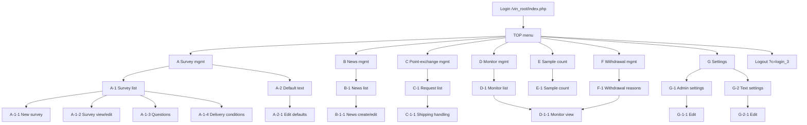
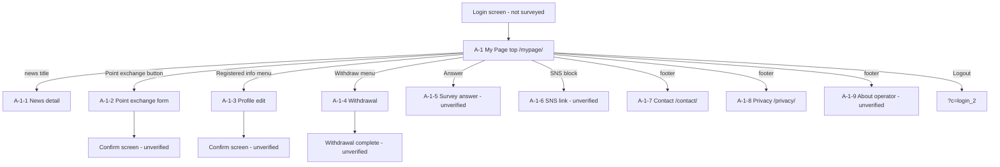

# Sitemap, Numbering Scheme and URL Table

## 1. Numbering scheme (shared by all source documents)

| Level | Code example | Meaning |
|-------|--------------|---------|
| 1 | `A`, `B`, … `G` | Group = left-menu heading (admin). For My Page there is only `A`. |
| 2 | `A-1`, `A-2` | Screen under a group (menu item). |
| 3 | `A-1-(1)` | Item (field, button, column) on that screen. |
| ext. | `A-1-1` | Child screen reached from a screen (create/edit/detail). |
| ext. | `A-1-1-(1)` | Item on a child screen. |

Diagram conventions in the PDFs: round badge = group, rounded-square badge = screen code; same letter = same colour; **solid line = verified, dashed line = unverified/inferred**. Screens that were deliberately not opened (destructive) are noted without codes.

## 2. Admin console (`/vin_root/`)

### 2.1 Admin screens and routes

| Code | Screen (JP) | Route (`/vin_root/index.php`) | Verified? |
|------|-------------|-------------------------------|-----------|
| A | アンケート管理 (heading only, not a link) | – | ✔ |
| A-1 | アンケート一覧 | `?c=questionnaire&new=1&odr=1` | ✔ |
| A-1-1 | アンケート新規登録 | `?c=questionnaire_1&new=1` | ✔ |
| A-1-2 | アンケート編集 (effectively read-only?) | `?c=questionnaire_1&pk=ID&new=1` | ✔ / questionable |
| A-1-3 | 設問管理 | `?c=question&questionnaire_pk=ID` (impl: `question_6`) | ✔ |
| A-1-4 | 配信条件一覧 | `?c=target&questionnaire_pk=ID` (impl: `target_5`) | ✔ |
| (no code) | 状態切替 | `?c=questionnaire_5&pk=ID&is_open=…` | not opened |
| (no code) | 削除 (new window) | `?c=questionnaire_3&pk=ID` | not opened |
| (no code) | テスト配信 (new window) | `?c=questionnaire_7&pk=ID` | not opened |
| (no code) | プレビュー | `preview/mypage/questionnaire/index.php?c=questionnaire_1&pk=<alt-id>`; question preview `?c=question_7&pk=ID` | partly |
| (no code) | CSV (5 downloads) | `?c=questionnaire_csv&pk=ID`, `?c=questionnaire_csv2&pk=ID[&type0=1][&preview=1]` | link seen |
| A-2 | デフォルト設定 | `?c=default_text&new=1` | ✔ |
| A-2-1 | デフォルト設定編集 | `?c=default_text_1&new=1` | ✔ (button click does nothing; direct URL works) |
| B | 新着情報管理 | – | ✔ |
| B-1 | 新着情報一覧 | `?c=topics&new=1` | ✔ |
| B-1-1 | 新着情報 登録/編集 | `?c=topics_1[&pk=ID]&new=1` | ✔ |
| (no code) | 削除 | `?c=topics_3&pk=ID` | not opened |
| (no code) | 行展開リンク | `?c=topics_5&pk=ID&is_open=0&sk=0` | purpose unclear |
| (no code) | タイトルプレビュー | `/topics/index.php?c=topics_view&pk=ID` (member site) | ✔ |
| C | ポイント交換管理 | – | ✔ |
| C-1 | 申請一覧 | `?c=trade&new=1` | ✔ |
| C-1-1 | 発送処理 (操作) | `?c=trade_1&pk=ID&new=1` | ✔ |
| (no code) | 発送状態を更新 (bulk) | in-page checkbox + button | not submitted |
| D | モニター管理 | – | ✔ |
| D-1 | モニター一覧 | `?c=monitor&new=1` | ✔ |
| D-1-1 | モニター閲覧 | `?c=monitor_1&pk=ID&new=1` | ✔ |
| (no code) | 有効/無効切替 | `?c=monitor_5&pk=ID&is_open=…` | **inferred**, not in Excel |
| (no code) | CSVインポート / エクスポート | in-page controls | existence confirmed |
| E | サンプル数調査 | – | ✔ |
| E-1 | サンプル数調査 | `?c=sample&new=1` | ✔ (no onward navigation) |
| F | 退会管理 | – | ✔ |
| F-1 | 退会理由 | `?c=secession&new=1` | ✔ |
| G | 設定 | – | ✔ |
| G-1 | 管理者設定 | `?c=m_admin&new=1` | ✔ |
| G-1-1 | 管理者設定編集 | `?c=m_admin_1&new=1` | ✔ |
| G-2 | 文章設定 | `?c=mail_text&new=1` | ✔ |
| G-2-1 | 文章設定編集 | `?c=mail_text_1&new=1` | ✔ |
| – | ログアウト | `?c=login_3` (same screen as login? unverified) | – |

## 3. Monitor My Page (`/mypage/`)

| Code | Screen | URL | Notes |
|------|--------|-----|-------|
| A-1 | マイページ（トップ） | `/mypage/` | Hub |
| A-1-1 | 新着情報詳細 | `/mypage/topics/index.php?c=topics_view&pk=ID` | |
| A-1-2 | ポイント交換申込み | `/mypage/trade/index.php` | Confirm screen unseen |
| A-1-3 | 登録情報の確認・変更 | `/mypage/edit/index.php` | Confirm screen unseen |
| A-1-4 | 退会 | `/mypage/secession/index.php` | Irreversible; not executed |
| A-1-5 | アンケート回答画面 | – | **Never observed** (no open survey was available) |
| A-1-6 | SNS連携画面 | – | JS OAuth, not exercised; slated for removal (Req. 4) |
| A-1-7 | お問い合わせ | `/contact/` | Fields: ID, company, name, e-mail, phone, body, reCAPTCHA. *Not in item-list Excel, added later* |
| A-1-8 | 個人情報保護方針 | `/privacy/` | Static; operator = 協同組合岡山情報文化研究所 |
| A-1-9 | 運営団体について | `http://www.vis-a-vis.co.jp/bunka/` | External; no capture |
| – | Logout | `?c=login_2` | |

## 4. Discrepancies between source documents

| Topic | Detail |
|-------|--------|
| Group C name | Transition diagram calls it **ポイント交換管理**; the requirements sheet calls its menu **申請一覧**. Same screen (`C-1`). |
| Group F name | "退会管理" group, screen "退会理由" (F-1). |
| Monitor/Admin tab names | Screen-description Excel has a sheet `UI項目一覧_G-1_管理者設定` whose title says "文章設定 (G-2)" – copy/paste slip. |
| My Page `A-1-2` capture sheet | Title on the capture tab says "新着情報詳細 A-1-1" – again a copy/paste slip. |
| Requirements Excel, No. 33/34 | New point-grant screens have group/screen code "？" – not yet placed in the menu structure. |
| Requirements No. 24 | Group column says "別資料" (separate document) – that is the registration-form comparison sheet. |
