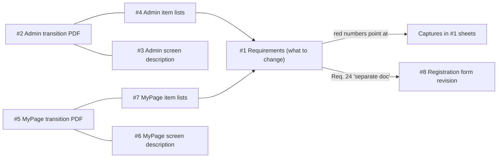

# Source Materials Index

Folder: `Vinsightリプレイス共有資料20260925（ビザビ佐藤）`

| # | File | Type | Date | Content | Summarised in |
|---|------|------|------|---------|---------------|
| 1 | `③Vinsight_要求事項（案）.xlsx` | XLSX (~9.9 MB, mostly images) | 2026-09-19, Rev.1 | Main sheet: requirement table (35 rows). Other sheets (12 tabs) hold current-system captures with red marks: モニターログイン, モニター A-1/A-2, 管理 A–G | [requirements.md](requirements.md) |
| 2 | `①…\Vinsight管理画面 ＜画面遷移図＞.pdf` | PDF, 6 pp | – | Admin screen transition diagram: groups A–G, child screens, routes, unverified/skipped items, record counts | [sitemap-and-urls.md](sitemap-and-urls.md), [flows.md](flows.md) |
| 3 | `①…\Vinsight管理画面＜画面説明＞20260917.xlsx` | XLSX (~5.8 MB) | 2026-09-17 | Annotated screenshots with code badges; 14 tabs (overview + one per screen). Text is titles only | [design-notes.md](design-notes.md) |
| 4 | `①…\Vinsight管理画面＜設計図＞20260917.xlsx` | XLSX | 2026-09-17 | Item lists, 20 tabs: numbering rule, screen tables, per-screen fields | [admin-screens.md](admin-screens.md), [data-model.md](data-model.md) |
| 5 | `②…\Vinsightモニター マイページ ＜画面遷移図＞.pdf` | PDF, 2 pp | – | My Page transition diagram | [sitemap-and-urls.md](sitemap-and-urls.md) |
| 6 | `②…\Vinsightモニター_マイページ＜画面説明＞20260918.xlsx` | XLSX (~1.4 MB) | 2026-09-18 | Annotated screenshots of My Page; 8 tabs | [monitor-mypage-screens.md](monitor-mypage-screens.md) |
| 7 | `②…\Vinsightモニター_マイページ＜設計図＞20260918.xlsx` | XLSX | 2026-09-18 | Item lists, 6 tabs | [monitor-mypage-screens.md](monitor-mypage-screens.md) |
| 8 | `②…\登録フォーム改定（案）2026-9-25.xlsx` | XLSX | 2026-09-25 | Old vs proposed registration form + CSV field comparison | [registration-form-redesign.md](registration-form-redesign.md) |

## Relationships

## How these documents were produced
- Text of all Excel sheets and PDFs was extracted programmatically (hidden/blank sheets included).
- Images embedded in the Excel files (screenshots, badges) were **not** interpreted.
- Content was reorganised into English topic files; Japanese terms retained where helpful. Nothing in the sources was altered; speculation is marked "inferred".
